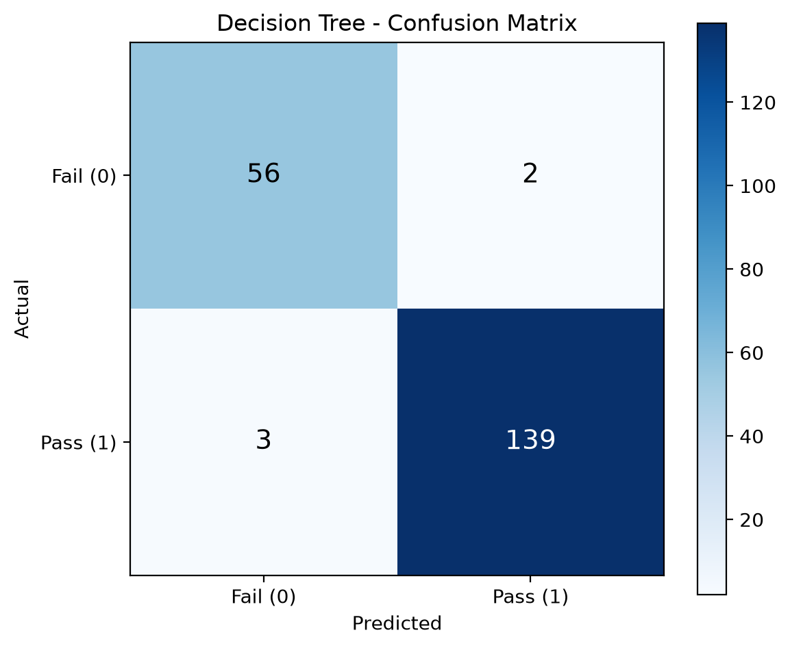
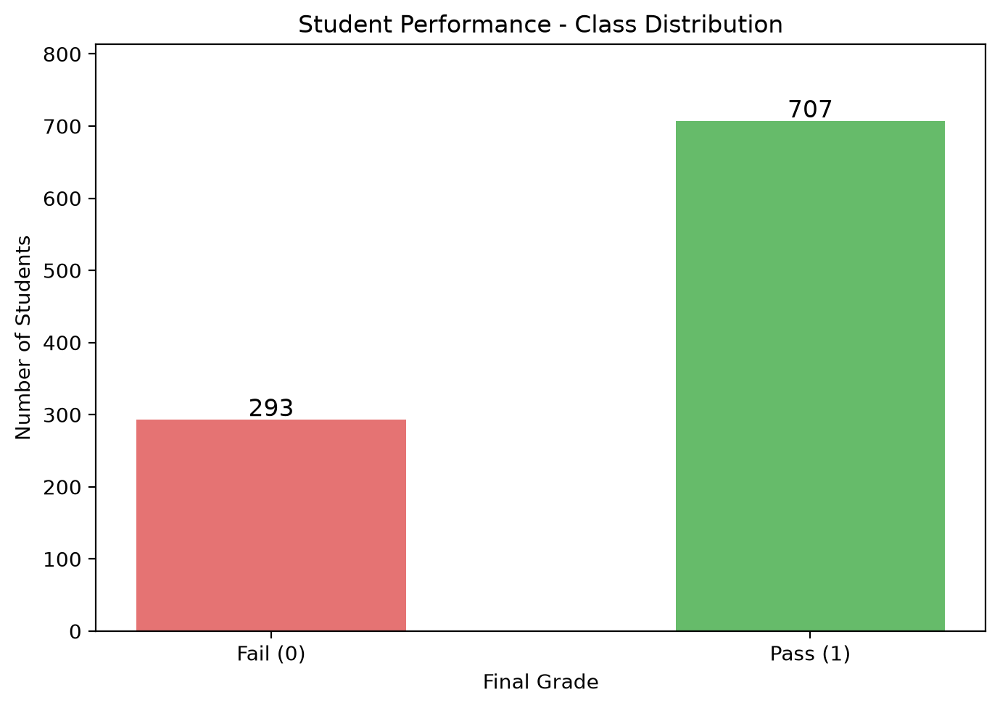
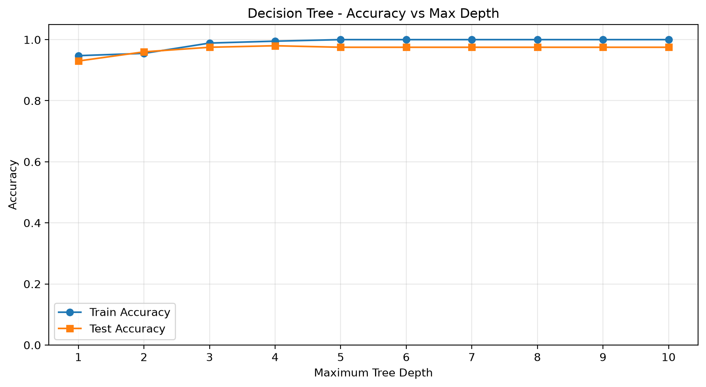
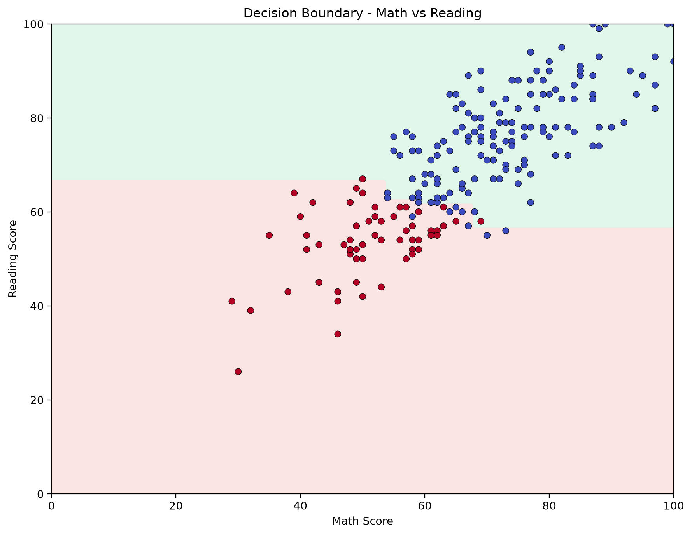

# Edu-Predict: Decision Tree Classifier from Scratch

## 1. Project Overview

Edu-Predict is a machine learning project that implements a Decision Tree classifier from scratch to predict student performance outcomes.

The model predicts whether a student will pass or fail based on demographic information, preparation habits, and exam scores.

The main goal is to understand the mathematical principles and algorithms behind decision trees without using high-level machine learning classifiers such as scikit-learn.

### Learning Objectives

- Understand how Decision Trees work.
- Apply probability, entropy, and Gini impurity.
- Calculate information gain to identify optimal splits.
- Explore combinatorics and computational complexity.
- Implement recursive tree construction from scratch.
- Evaluate classification performance.
- Visualize the trained Decision Tree.

---

## 2. Dataset

The project uses the Students Performance in Exams dataset from Kaggle.

Dataset source:
https://www.kaggle.com/datasets/spscientist/students-performance-in-exams

The dataset contains 1,000 student records.

### Features

| Feature | Description |
|---|---|
| gender | Student gender |
| race/ethnicity | Student group classification |
| parental level of education | Highest parental education level |
| lunch | Standard or free/reduced lunch |
| test preparation course | Completed or not completed |
| math score | Mathematics exam score |
| reading score | Reading exam score |
| writing score | Writing exam score |

### Target Variable

A new column, `final_grade`, is created based on the average exam score.

- Pass (1): Average score > 60
- Fail (0): Average score <= 60

```python
df["final_grade"] = (
    (
        df["math score"] +
        df["reading score"] +
        df["writing score"]
    ) / 3 > 60
).astype(int)
```

### Class Distribution

| Class | Students | Percentage |
|---|---:|---:|
| Fail (0) | 293 | 29.3% |
| Pass (1) | 707 | 70.7% |
| Total | 1000 | 100% |

The dataset is moderately imbalanced, with more students passing than failing.

---

## 3. Data Preprocessing

The preprocessing pipeline includes:

1. Loading the dataset using Pandas.
2. Checking the dataset structure.
3. Creating the target variable `final_grade`.
4. Splitting the dataset into training and testing sets.
5. Encoding categorical variables as integers.
6. Preparing numerical features for model training.

### Train/Test Split

- Training set: 80% (800 students)
- Testing set: 20% (200 students)
- Random state: 42

Categorical encoding mappings are derived from the training data to avoid test-set leakage.

### Feature Sets

Two feature configurations are compared.

**Model 1: Five features**

- gender
- race/ethnicity
- parental level of education
- lunch
- test preparation course

**Model 2: Eight features**

The same five features plus:

- math score
- reading score
- writing score

The eight-feature model is the main model used for evaluation and visualization.

Note: The target variable is calculated directly from the three exam scores. Therefore, the eight-feature model learns to approximate an existing grading rule rather than predicting performance before exams.

---

## 4. Mathematical Background

### 4.1 Probability

Probability measures how frequently a particular class occurs within a dataset or tree node.

Formula:

`p(c) = number_of_samples_in_class_c / total_samples`

For example, if 70 out of 100 students pass:

`P(Pass) = 70 / 100 = 0.70`

### 4.2 Entropy

Entropy measures uncertainty or impurity in a dataset.

Formula:

`H(S) = -sum(p(c) * log2(p(c)))`

Where:

- S is the dataset or node.
- c represents a class.
- p(c) is the probability of class c.
- log2 is the base-2 logarithm.

Interpretation:

- Entropy = 0: All samples belong to one class.
- Entropy = 1: Two classes are equally distributed.
- Higher entropy indicates greater uncertainty.

Terms with probability zero contribute zero to the entropy.

### 4.3 Gini Impurity

Gini impurity is another measure of class impurity.

Formula:

`Gini(S) = 1 - sum(p(c)^2)`

Interpretation:

- Gini = 0: Pure node.
- Gini = 0.5: Maximum impurity for two equally distributed classes.

The project implements Gini impurity for mathematical analysis.

However, the Decision Tree uses entropy-based information gain as its splitting criterion.

### 4.4 Information Gain

Information Gain measures how much a split reduces uncertainty.

Formula:

`IG(S, A) = H(S) - sum((size(S_v) / size(S)) * H(S_v))`

Where:

- S is the parent dataset.
- A is the candidate splitting feature.
- S_v represents a child subset.
- H(S) is the parent entropy.
- H(S_v) is the child entropy.

The algorithm selects the split with the highest positive information gain.

---

## 5. Combinatorics and Split Complexity

Combinatorics helps explain how many possible splitting decisions the algorithm may evaluate.

### Number of Features

For a dataset containing d features, the algorithm considers up to d features at each node.

In this project:

`d = 8`

Therefore, the main model considers eight features when searching for the best split.

The number of ways to choose k features from d available features is:

`C(d, k) = d! / (k! * (d-k)!)`

For example:

`C(8, 2) = 28`

There are 28 possible unordered pairs of features.

However, the implemented Decision Tree selects one splitting feature at a time rather than evaluating feature pairs.

### Numerical Thresholds

For a numerical feature containing u unique sorted values, there are at most:

`u - 1`

candidate threshold positions between consecutive values.

For example:

- Unique values: 10
- Possible thresholds: 9

The implementation searches for informative thresholds and selects the candidate producing the largest information gain.

### Computational Complexity

Let:

- d = number of features
- n = number of samples in a node
- t = number of candidate thresholds per feature

If each candidate is evaluated by scanning all samples, the approximate cost of finding the best split is:

`O(d * t * n)`

When the number of thresholds grows proportionally to n, this can approach:

`O(d * n^2)`

per node.

The overall training cost depends on the number and sizes of nodes created during recursive tree construction.

Maximum depth and minimum sample requirements help control tree growth.

---

## 6. Decision Tree Implementation

The Decision Tree classifier is implemented from scratch in:

`model/decision_tree.py`

The implementation includes:

- A custom Node class.
- Entropy-based information gain.
- Recursive tree construction.
- Searching for the best feature and threshold.
- Numerical threshold-based splitting.
- Support for numerically encoded categorical features.
- Prediction using tree traversal.
- Text-based tree visualization.

### Node Structure

Each node stores:

- prediction
- feature_index
- threshold
- left
- right

### Stopping Criteria

Tree construction stops when:

1. The node is pure.
2. Maximum tree depth is reached.
3. The node contains fewer samples than `min_samples_split`.
4. No useful split can be found.

### Model Configuration

The primary model uses:

```python
tree_full = DecisionTree(
    max_depth=5,
    min_samples_split=2
)
```

The model is trained using 800 student records and evaluated on 200 test records.

### Categorical Features

Categorical variables are converted to integer codes before training.

The current implementation applies numerical threshold comparisons to these encoded values.

This is a limitation because integer codes may introduce an artificial ordering between nominal categories.

---

## 7. Model Evaluation

### Accuracy Comparison

| Model | Test Accuracy |
|---|---:|
| Decision Tree - 5 features | 67.50% |
| Decision Tree - 8 features | 97.50% |
| Dummy Baseline | 71.00% |
| Decision Tree - 2D | 95.50% |

The eight-feature Decision Tree correctly classified 195 out of 200 test records.

The dummy baseline always predicts the most frequent class observed in the training set.

### Confusion Matrix

Results for the eight-feature Decision Tree with maximum depth 5:

| Actual / Predicted | Fail (0) | Pass (1) |
|---|---:|---:|
| Fail (0) | 56 | 2 |
| Pass (1) | 3 | 139 |

### Interpretation

- True Negative (TN): 56
- False Positive (FP): 2
- False Negative (FN): 3
- True Positive (TP): 139

Total correct predictions:

`56 + 139 = 195`

Total incorrect predictions:

`2 + 3 = 5`

Accuracy:

`Accuracy = 195 / 200 = 0.975 = 97.50%`

The model substantially outperforms the majority-class baseline when exam scores are included.

---

## 8. Tree Depth Comparison

The project evaluates Decision Trees with maximum depths from 1 to 10.

| Max Depth | Train Accuracy | Test Accuracy |
|---|---:|---:|
| 1 | 94.75% | 93.00% |
| 2 | 95.50% | 96.00% |
| 3 | 98.88% | 97.50% |
| 4 | 99.50% | 98.00% |
| 5 | 100.00% | 97.50% |
| 6 | 100.00% | 97.50% |
| 7 | 100.00% | 97.50% |
| 8 | 100.00% | 97.50% |
| 9 | 100.00% | 97.50% |
| 10 | 100.00% | 97.50% |

### Findings

The highest observed test accuracy is:

`98.00% at max_depth = 4`

At depth 5, training accuracy reaches 100%, while test accuracy decreases slightly to 97.50%.

This suggests that deeper trees do not necessarily improve generalization.

The depth comparison is an exploratory experiment. Selecting an optimal depth for final evaluation should ideally use a validation set or cross-validation within the training data.

---

## 9. Results and Visualizations

All generated results are stored in the `results/` directory.

### 9.1 Tree Visualization

File: `results/tree_visualization.png`

Displays the complete structure of the trained Decision Tree, including:

- Splitting features.
- Threshold values.
- Left and right branches.
- Final Pass/Fail predictions.


### 9.2 Confusion Matrix

File: `results/confusion_matrix.png`

Visualizes correct and incorrect predictions for both classes.



### 9.3 Class Distribution

File: `results/class_distribution.png`

Shows the distribution of Pass and Fail outcomes in the dataset.



### 9.4 Tree Depth Comparison

File: `results/depth_comparison.png`

Compares training and testing accuracy across maximum tree depths from 1 to 10.



### 9.5 Decision Boundary 2D

File: `results/decision_boundary_2d.png`

Displays classification regions using two numerical features:

- Math score
- Reading score

A separate Decision Tree is trained using only these two features.

Test accuracy:

`95.50%`



### 9.6 Metrics JSON

File: `results/metrics.json`

Stores evaluation results in a structured format, including:

- Accuracy values.
- Baseline accuracy.
- Best observed depth.
- Confusion matrix values.
- Class distribution.

### 9.7 Tree Structure TXT

File: `results/tree_structure.txt`

Contains a text representation of the Decision Tree rules.

Example:

```text
if reading score <= 61.500:
  if math score <= 60.500:
    if writing score <= 65.500:
      Predict class = 0
```

This format makes model predictions easier to interpret without opening the graphical visualization.

---

## 10. Project Structure

```text
edu-predict/
|
|-- data/
|   |-- StudentsPerformance.csv
|
|-- model/
|   |-- decision_tree.py
|
|-- notebook/
|   |-- analysis.ipynb
|
|-- utils/
|   |-- metrics.py
|
|-- results/
|   |-- class_distribution.png
|   |-- confusion_matrix.png
|   |-- decision_boundary_2d.png
|   |-- depth_comparison.png
|   |-- metrics.json
|   |-- tree_structure.txt
|   |-- tree_visualization.png
|
|-- README.md
|-- requirements.txt
|-- .gitignore
```

---

## 11. How to Run the Project

### Prerequisites

Make sure the following tools are installed:

- Python 3.11 or newer
- Git
- Visual Studio Code (recommended)
- Python extension for VS Code
- Jupyter extension for VS Code

The project was developed using Python 3.14.7.

### Step 1. Clone the Repository

Clone the project from Tomorrow School Gitea:

```bash
git clone https://01.tomorrow-school.ai/git/aongalba/edu-predict.git
```

Navigate into the project folder:

```bash
cd edu-predict
```

Alternatively, download the repository as a ZIP file and extract it.

### Step 2. Create a Virtual Environment

On macOS or Linux:

```bash
python3 -m venv .venv
```

Activate:

```bash
source .venv/bin/activate
```

On Windows:

```powershell
python -m venv .venv
```

Activate in PowerShell:

```powershell
.\.venv\Scripts\Activate.ps1
```

### Step 3. Install Dependencies

Run:

```bash
python -m pip install --upgrade pip
python -m pip install -r requirements.txt
```

The project uses:

- NumPy
- Pandas
- Matplotlib
- Jupyter
- ipykernel

No scikit-learn DecisionTreeClassifier is used.

### Step 4. Open the Project in VS Code

Open the project folder:

`edu-predict/`

Then open:

`notebook/analysis.ipynb`

### Step 5. Select the Python Kernel

In the top-right corner of the Notebook:

1. Click Select Kernel.
2. Choose Python Environments.
3. Select the Python interpreter from `.venv`.
4. Make sure the kernel starts successfully.

### Step 6. Run the Notebook

Run all cells from top to bottom using:

`Run All`

The Notebook performs the following operations:

1. Loads the dataset.
2. Creates the target variable.
3. Preprocesses the features.
4. Splits the data into training and testing sets.
5. Computes entropy, Gini impurity, and information gain.
6. Trains the custom Decision Tree.
7. Generates predictions.
8. Evaluates model accuracy.
9. Computes the confusion matrix.
10. Compares the model with a dummy baseline.
11. Visualizes the tree.
12. Creates additional evaluation plots.
13. Exports generated results.

### Step 7. Check the Results

After successful execution, open:

`results/`

The generated PNG, JSON, and TXT files can be inspected directly.

### Working Directory Notes

The Notebook uses paths relative to the project working directory.

For reliable execution:

- Open the complete repository rather than the Notebook alone.
- Run Jupyter from the project root or the `notebook` directory.
- Keep the original folder structure unchanged.
- Run all cells sequentially.

Generated result paths depend on the location of the project on the current computer.

For example, the same project can be stored under different user directories on macOS, Linux, or Windows.

No fixed personal directory is required for the result-export code when the Notebook is launched from the expected project location.

---

## 12. Limitations

The following limitations should be considered:

1. The main target is calculated from the same exam scores included in the eight-feature model.

2. Therefore, the model is primarily a demonstration of Decision Tree learning rather than a real early-warning prediction system.

3. Label-encoded categorical features are split using numerical thresholds, which may impose arbitrary ordering.

4. A single train/test split does not fully establish model generalization.

5. Hyperparameter selection should ideally use a separate validation process.

6. Demographic variables should be interpreted carefully and should not be used to make unfair decisions about students.

---

## 13. Conclusion

This project demonstrates the implementation of a Decision Tree classifier from scratch using fundamental machine learning concepts.

The project covers:

- Probability
- Entropy
- Gini impurity
- Information Gain
- Combinatorics
- Recursive decision making
- Model evaluation
- Tree visualization

The eight-feature Decision Tree achieved 97.50% accuracy on the test dataset.

The best observed accuracy in the depth comparison was 98.00% at maximum depth 4.

The results demonstrate how decision trees learn classification rules from data and how feature selection and tree depth influence prediction performance.

The project also highlights the importance of model interpretability, careful evaluation, and understanding the limitations of predictive modeling.
