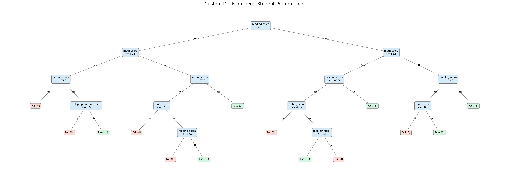

# Edu-Predict: Decision Tree Classifier from Scratch

A custom, interpretable **Decision Tree classifier** for predicting student exam outcomes (**Pass** or **Fail**) using the *Students Performance in Exams* dataset. The tree-building and prediction algorithm is implemented **from scratch**, without `scikit-learn`'s `DecisionTreeClassifier`.

## Project objective

This project demonstrates how a decision tree selects splits using **probability**, **entropy**, and **information gain**, and how its predictions can be evaluated and explained. It also explores Gini impurity and the combinatorics of candidate splits.

> **Interpretation caveat:** The target is calculated directly from the three exam scores. When those scores are used as inputs, the model is learning to approximate a known grading rule, **not** predicting performance before the exams. The five-feature experiment without scores provides a more limited comparison.

## Dataset

Source: [Kaggle — Students Performance in Exams](https://www.kaggle.com/datasets/spscientist/students-performance-in-exams)

The dataset contains **1,000 student records** and eight original input features:

| Feature | Meaning | Type |
| --- | --- | --- |
| `gender` | Student gender | Categorical |
| `race/ethnicity` | Group classification | Categorical |
| `parental level of education` | Parent's education level | Categorical |
| `lunch` | Lunch category | Categorical |
| `test preparation course` | Test preparation status | Categorical |
| `math score` | Mathematics exam score | Numerical |
| `reading score` | Reading exam score | Numerical |
| `writing score` | Writing exam score | Numerical |

### Target variable

The new target `final_grade` is **1 (Pass)** if the average score is **strictly greater than 60**, otherwise **0 (Fail)**:

```python
df["final_grade"] = (
    (df["math score"] + df["reading score"] + df["writing score"]) / 3 > 60
).astype(int)
```

An average of exactly 60 is **Fail (0)**.

## Data preprocessing

1. Load `data/StudentsPerformance.csv` with Pandas.
2. Create the target `final_grade`.
3. Split into **80% training / 20% test**, with `random_state=42` (**800 / 200 records**).
4. Map each categorical feature to integer codes; derive category mappings from the training partition to avoid fitting preprocessing on the test partition.
5. Compare two feature configurations:
   - **5 features:** the five categorical background/preparation features.
   - **8 features:** the same five features plus math, reading, and writing scores.

**Categorical-variable limitation:** The current implementation converts categories to integer labels and searches numerical `<=` thresholds across them. This works computationally, but it imposes an artificial order on nominal categories (e.g., `race/ethnicity`). A dedicated categorical subset split would be a meaningful future improvement.

## Mathematical background

### Probability

For class \(c\) in a node with \(n\) samples, its empirical probability is:

\[
p(c) = \frac{\text{number of samples of class }c}{n}
\]

### Entropy

Entropy measures class uncertainty:

\[
H(S) = -\sum_c p(c)\log_2 p(c)
\]

Terms with \(p(c)=0\) contribute zero. Entropy is **0** for a pure node and **1** for an evenly split binary node.

### Gini impurity

Gini measures class mixture in another way:

\[
Gini(S) = 1 - \sum_c p(c)^2
\]

For two balanced classes, Gini is **0.5**. The project implements Gini for comparison, while **entropy-based information gain** is the actual split criterion.

### Information gain

For a split into child partitions \(S_v\):

\[
IG(S,A) = H(S) - \sum_v \frac{|S_v|}{|S|}H(S_v)
\]

The algorithm chooses the candidate split with the **largest positive information gain**.

## Combinatorics and computational complexity

At a node with **\(d\)** input features, the implementation considers up to **\(d\) features** (here, **8** in the full model). A feature with **\(u_j\)** distinct observed values supplies up to **\(u_j - 1\)** candidate thresholds: the midpoints between sorted, consecutive unique values.

Therefore, the maximum number of threshold candidates inspected at a node is:

\[
T = \sum_{j=1}^{d}\max(u_j-1,0)
\]

For example, 10 distinct values in one feature give **9** candidate thresholds.

A separate combinatorics observation: selecting any nonempty subset from \(d\) features gives \(2^d-1\) possible subsets (255 for 8 features). **This implementation does not enumerate these feature subsets**; it tests one feature and one threshold at a time.

With **\(n\)** rows at a node, checking a threshold requires scanning and splitting the rows, giving approximately **\(O(nT)\)** split-search work (plus costs such as sorting unique values). Since \(T\le d(n-1)\), a simple worst-case bound is approximately **\(O(dn^2)\) per node** for this unoptimized implementation. Total training cost depends on the number and sizes of nodes. `max_depth` and `min_samples_split` limit tree growth.

## Custom Decision Tree implementation

The model is defined in `model/decision_tree.py` and includes:

- A `Node` data class storing `prediction`, `feature_index`, `threshold`, `left`, and `right`.
- Exhaustive candidate threshold search and entropy-based information gain.
- Recursive tree construction.
- Stopping conditions: pure labels, maximum depth, minimum samples, or no positive information gain.
- `fit()`, `predict()`, and a text display of the decision rules.

The experiments use:

```python
DecisionTree(max_depth=5, min_samples_split=2)
```

The root of the eight-feature tree splits on **`reading score <= 61.5`**. All leaf predictions are **0 (Fail)** or **1 (Pass)**.

## Evaluation results

Test set: **200 students**.

| Method | Test accuracy | Correct predictions |
| --- | ---: | ---: |
| Custom Decision Tree — 5 features | 67.50% | 135 / 200 |
| Custom Decision Tree — 8 features | **97.50%** | **195 / 200** |
| Majority-class dummy baseline | 71.00% | 142 / 200 |

The majority-class baseline always predicts the most frequent class observed in the **training set**.

### Confusion matrix — eight-feature model

Rows represent actual classes; columns represent predicted classes.

| | Predicted Fail (0) | Predicted Pass (1) |
| --- | ---: | ---: |
| **Actual Fail (0)** | **56** (TN) | **2** (FP) |
| **Actual Pass (1)** | **3** (FN) | **139** (TP) |

- **True negatives:** 56
- **False positives:** 2
- **False negatives:** 3
- **True positives:** 139
- **Total errors:** 5

The eight-feature tree exceeds the project's suggested **75% accuracy** target, but this result must be interpreted in light of the target's dependence on exam-score inputs.

## Tree visualization

The notebook prints the tree's decision rules and exports a graphical representation to:



Blue nodes show split conditions; green leaves represent **Pass** and pink leaves represent **Fail**. Branch labels **Yes** and **No** correspond to the threshold condition being true or false.

## Project structure

```text
edu-predict/
├── data/
│   └── StudentsPerformance.csv
├── model/
│   └── decision_tree.py
├── notebook/
│   └── analysis.ipynb
├── utils/
│   └── metrics.py
├── results/
│   └── tree_visualization.png
├── README.md
└── requirements.txt
```

## Setup and usage

Use a compatible Python 3 environment and run commands from the **project root**:

```bash
python3 -m venv .venv
source .venv/bin/activate        # macOS / Linux
python -m pip install -r requirements.txt ipykernel
```

In VS Code:

1. Open the `edu-predict` folder.
2. Open `notebook/analysis.ipynb`.
3. Select the `.venv` Python kernel.
4. Run notebook cells **from top to bottom**.
5. Inspect printed metrics, the confusion matrix, and the rendered tree in `results/tree_visualization.png`.

If the notebook cannot locate the dataset or import project modules, make sure the notebook's working directory and Python import path match the paths used in its cells.

## Conclusions

- The classifier was implemented from scratch, using entropy-based information gain rather than a ready-made decision-tree estimator.
- Adding exam scores increased test accuracy from **67.50%** to **97.50%**, exceeding the **71.00%** dummy baseline.
- The tree can be explained through explicit decision thresholds and leaf predictions.
- The experiment demonstrates both the value of informative features and the risk of treating a constructed target as an independent future outcome.

## Potential improvements

- Handle nominal categories via explicit equality or subset-based categorical splits.
- Compare different maximum tree depths on a validation split.
- Visualize two-feature decision boundaries.
- Add reusable tests for entropy, information gain, and tree prediction.
- Evaluate genuine early-risk prediction using only information available **before** final exam scores are known.
